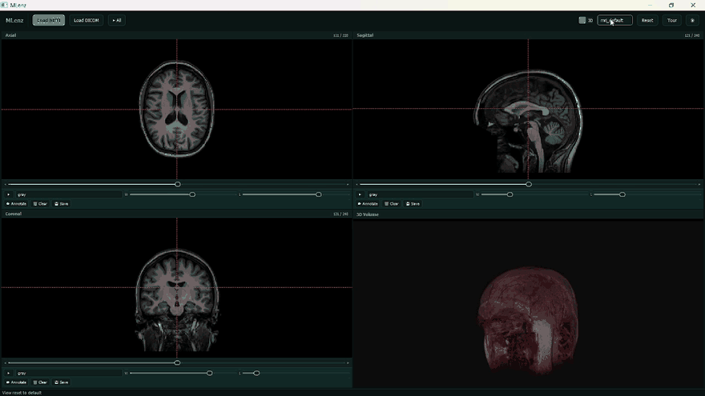
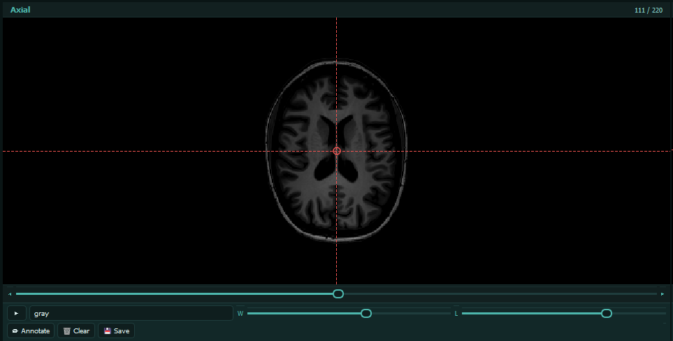
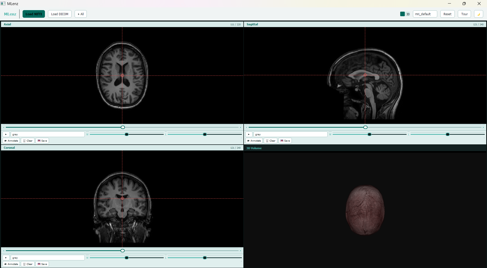

<div align="center">

# MLenz

**Multi-planar reconstruction viewer for MRI and CT**

[](https://basselshaheen06.github.io)
[](https://github.com/BasselShaheen06/MLenz/actions/workflows/ci.yml)
[](LICENSE)
[](https://www.python.org)

</div>



MLenz opens a NIfTI or DICOM volume and shows it as three synchronized planes —
Axial, Coronal, Sagittal — with draggable crosshairs and a fourth panel that
ray-casts the volume in 3D. Every plane carries its own cine controls, colormap,
window/level sliders, freehand annotation and PNG export.

Built for fast review and teaching: the volume loads in the background, slices
are cached with neighbour prefetch, and the 3D view sits next to the slices
instead of in a separate window.

---

## What it does

- **Navigate in three planes at once.** Drag any crosshair and the other two
  follow, so you always know where you are in the volume.
- **Adjust what you see, per plane.** Each viewport has independent
  window/level, colormap and cine — standard PACS behaviour.
- **Look inside without leaving.** A VTK GPU ray-cast panel renders the whole
  volume with switchable transfer functions.

---

## Screenshots

<table>
  <tr>
    <td width="50%"><br><sub><b>Start screen</b> — recent scans, one click away</sub></td>
    <td width="50%"><br><sub><b>3D volume</b> — VTK ray-cast beside the slices</sub></td>
  </tr>
  <tr>
    <td width="50%"><br><sub><b>Colormaps</b> — one per plane, applied live</sub></td>
    <td width="50%"><br><sub><b>Annotations</b> — freehand drawing, exported as PNG</sub></td>
  </tr>
  <tr>
    <td width="50%"><br><sub><b>Window / Level</b> — independent contrast and brightness per plane</sub></td>
    <td width="50%"><br><sub><b>Light mode</b> — dark clinical default, light on request</sub></td>
  </tr>
</table>

---

## Features

| Feature | Details |
|---|---|
| **MPR planes** | Axial · Coronal · Sagittal — synchronized |
| **Crosshairs** | Draggable `InfiniteLine` — drag any line to update all planes |
| **File formats** | NIfTI `.nii`/`.nii.gz` · single DICOM `.dcm` |
| **Per-viewport controls** | ▶ Play/Pause · colormap · W slider · L slider — embedded in each plane |
| **CT window presets** | Brain · Bone · Lung · Soft tissue · Angio — in Hounsfield units |
| **Global cine** | ▶ All / ⏸ All — play every plane together |
| **Annotation mode** | Freehand drawing, clear, export as PNG |
| **3D rendering** | VTK GPU ray-cast embedded as 4th viewport |
| **Transfer functions** | MRI default · Bone · Angio · PET |
| **Theme** | Dark (clinical default, follows system) + light mode toggle |
| **Background loading** | `QThread` — UI stays responsive on large volumes |
| **Slice cache** | LRU cache + neighbour prefetch for fast navigation |
| **Guided tour** | Step-by-step overlay with spotlight prompts |
| **Anisotropy aware** | Non-cubic voxels are scaled so anatomy keeps its proportions |

---

## Install

```bash
git clone https://github.com/BasselShaheen06/MLenz.git
cd MLenz
python -m venv venv

venv\Scripts\activate      # Windows
source venv/bin/activate   # macOS / Linux

pip install -r requirements.txt
python main.py
```

Or install it as a package and launch it from anywhere:

```bash
pip install .
mlenz
```

Python 3.10 or newer. VTK needs a GPU with OpenGL 3.2+ for the 3D panel.

---

## Try it

The repository ships a **synthetic head CT** so the CT path can be tried without
any patient data:

1. Launch MLenz, press **Load DICOM**, open `samples/sample_ct_head.dcm`.
2. Pick a window from the **Preset** menu under any plane — Brain, Bone, Lung,
   Soft tissue, Angio. The presets are in Hounsfield units.
3. Press **Load NIfTI** and open `Dataset/sub-0003_T1w.nii.gz` for an MRI.

The phantom is generated by `mlenz/core/phantom.py` — an ellipsoidal head with
skull, ventricles, a hyperdense lesion and an air sinus, all in HU. Regenerate
or resize it with:

```bash
python tools/make_sample_ct.py --slices 64 --size 160
```

Real `.dcm` files are git-ignored; `samples/` is the single exception, and it is
synthetic by construction.

---

## Documentation

- **Guides and the science behind the viewer** — published on the
  [portfolio site](https://basselshaheen06.github.io).
  <!-- TODO: replace with the MLenz page URL once the portfolio is live -->
- **API reference** — [`docs/api/loader.md`](docs/api/loader.md) and
  [`docs/api/renderer.md`](docs/api/renderer.md) stay in this repository,
  next to the code they describe.

The `docs/` folder is plain Markdown and is the single source of truth for both.
See [`docs/README.md`](docs/README.md) for how the pages are published.

---

## Architecture

```
mlenz/
├── app.py             # entry point — QApplication, theme, main window
├── core/
│   ├── loader.py      # NIfTI + DICOM loading, VolumeData — no UI
│   ├── geometry.py    # aspect-ratio maths for anisotropic voxels
│   └── renderer.py    # VTK pipeline, transfer function presets — no UI
└── ui/
    ├── viewport.py    # SliceViewport — pyqtgraph canvas, crosshairs, annotation
    ├── controls.py    # TopBar (global actions)
    ├── main_window.py # Wiring, crosshair sync, cine timers, background load
    ├── theme.py       # Dark / light palettes, ThemeManager
    └── tour.py        # Guided-tour overlay
```

`core/` has no UI dependencies — it works in scripts and notebooks:

```python
from mlenz.core.loader import load_nifti

volume = load_nifti("sub-0003_T1w.nii.gz")
print(volume.data.shape)        # (Z, Y, X)
print(volume.spacing_zyx)       # millimetres per voxel, same axis order
print(volume.physical_extent)   # volume size in millimetres
```

---

## Limitations

Written down rather than hidden, because they decide what the tool is for today:

- **Single-file DICOM only.** No folder/series import and no multi-frame DICOM.
- **Through-plane spacing is assumed.** For a single DICOM file, `SliceThickness`
  is ignored and z-spacing is taken as 1 mm.
- **Window/level works on normalized intensities.** CT volumes can be read in
  Hounsfield units and windowed with clinical presets, but the sliders still
  operate on the normalised scale, so the readout is not in HU yet.
- **Read-only.** No DICOM export, anonymisation, segmentation or registration yet.
- **NIfTI and DICOM only.** No NRRD or DICOMDIR.
- **Interactive testing is on Windows.** CI runs the test suite and a headless
  import smoke test on Linux.

---

## Development

```bash
pip install -r requirements-dev.txt
pytest
ruff check .
```

Tests cover the loaders, metadata preservation and the aspect-ratio geometry;
the GUI is verified with a headless `QT_QPA_PLATFORM=offscreen` smoke test in CI.

---

## License

MIT — Bassel Shaheen, Cairo University SBME
